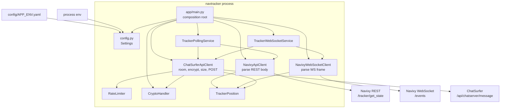
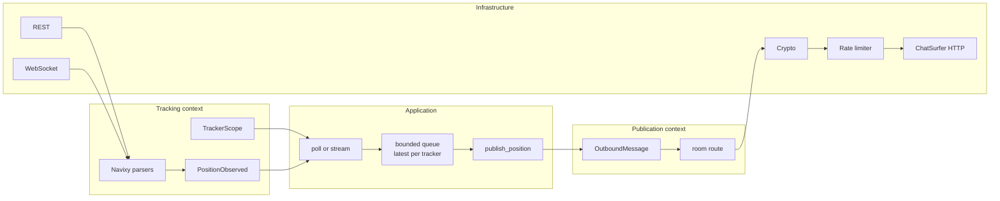

# NavTracker architecture review

Reviewed from the tree at `9126563` (branch `master`). This is a static review of the repository as it exists. The service was not run against Navixy or ChatSurfer. One config fact was checked locally: PyYAML loads `fernet_key: None` in the environment YAML files as the string `"None"`, not as a null.

The existing [Architecture.md](../Architecture.md) describes intent and stops at the context diagram. This document compares that intent with the code, then proposes a target shape. No application code was changed for this review.

## 1. What the system does today

NavTracker is a single-process Python 3.12 asyncio worker. It has no HTTP server, no database, and no user interface. Its job is to turn live tracker positions from Navixy into chat messages in ChatSurfer.

On startup `app/main.py` loads settings, optionally builds a `CryptoHandler`, builds a `ChatSurferApiClient`, and then runs one of two loops until the process is killed:

- **Poll mode** (`TrackerPollingService`): for each configured tracker id, `POST /tracker/get_state` on the Navixy REST API, map the body to a `TrackerPosition`, and `POST /api/chatserver/message` on ChatSurfer. Sleep for `poll_interval_seconds` and repeat. Development and staging YAML select this mode.
- **WebSocket mode** (`TrackerWebSocketService`): subscribe to `wss://ws.navixy.com/events`, parse each frame, and publish the same way. Production YAML selects this mode.

Outbound messages can be hybrid-encrypted (AES-256-GCM, with the data key wrapped by RSA-OAEP) or Fernet-encrypted. Encryption also switches the ChatSurfer room from `freedom_flag` to `freedom_flag_encrypted`. A process-local rate limiter spaces ChatSurfer calls. mTLS client certificates are presented to ChatSurfer so the upstream can resolve the user classification.

The stated non-goals in `Architecture.md` match the code: no stored history, no replay, no dashboard, no multi-tenant users, no tracker discovery, no delivery guarantee across restarts.

### Tech stack

| Concern | Choice |
| --- | --- |
| Language / runtime | Python 3.12 (`python:3.12-slim`), asyncio |
| HTTP / WebSocket | `httpx==0.28.1`, `websockets==15.0.1` |
| Config | PyYAML files under `config/` plus environment variables |
| Crypto | `cryptography==46.0.1` (RSA-OAEP, AES-GCM, Fernet, PEM/SSH key loaders) |
| Packaging | `requirements.txt` only. No `pyproject.toml`, no installable package, no `app/__init__.py` |
| Deploy | `Dockerfile`, `docker-compose.yml` for one service |
| Docs | `Architecture.md` (intent sketch), `docs/Installation.txt` (three commands) |

### Module map

```text
app/main.py                         composition root and process entry
app/domain/entities.py              TrackerPosition
app/domain/ports.py                 TrackerDataSource, MessagePublisher
app/application/services.py         poll loop, websocket loop
app/infrastructure/navixy_api.py    REST adapter and JSON mapping
app/infrastructure/navixy_ws.py     WebSocket adapter, subscribe, JSON mapping
app/infrastructure/chatsurfer.py    HTTP publisher, room choice, size check
app/infrastructure/crypto.py        encrypt / decrypt
app/infrastructure/limiter.py       in-process interval limiter
app/infrastructure/config.py        YAML + env settings
config/{development,staging,production}.yaml
certs/ca-bundle.crt                 trust bundle baked into the image
```

About 1,000 lines of Python. The layer folders are real: `application/services.py` imports only `app.domain`. Infrastructure imports the domain entity and is wired in `main`. That dependency direction is the healthiest part of the design, and it is still small enough to correct the gaps below before a second integration or a UI lands on top of it.

### Current runtime architecture



Both ingestion adapters construct `TrackerPosition` themselves. The application services move that object straight to `publish`. Policy that decides whether a position is worth sending, which room it belongs in, and what happens when ChatSurfer rejects it sits in the adapters and the loops, not in the domain.

## 2. Domain model

### Bounded contexts that are already visible

Two contexts are doing the work, even though the tree has a single `domain/` package:

| Context | Ubiquitous language already in the code | Where it actually lives |
| --- | --- | --- |
| Tracking | tracker, position, latitude, longitude, heading, speed, altitude, connection status, movement status, poll, stream | `TrackerPosition`, both Navixy adapters, both application loops |
| Publication | message, room, nickname, classification, user high classification, domain, encryption, rate limit | `ChatSurferApiClient`, `CryptoHandler`, `RateLimiter`, and the ChatSurfer block of `Settings` |

A third, implicit context is **identity and trust**: Navixy API hash, ChatSurfer API key, mTLS client cert, and the encryption key. Those are infrastructure credentials. They are mixed into the same flat `Settings` dataclass as tracker ids and room names (`app/infrastructure/config.py`).

There is no context map, no published language between the two contexts, and no domain event. The object that crosses the boundary is `TrackerPosition`, and the publisher is defined as `publish(position: TrackerPosition)`. Publication therefore speaks tracking language. ChatSurfer field names (`domainId`, `roomName`, `userHighClassification`) correctly stay inside the adapter. The missing concept is an outbound message with its own rules: which room, whether it must be encrypted, the maximum size, and a schema version.

### Aggregates, entities, and value objects

`TrackerPosition` is a frozen dataclass. That immutability is appropriate. It is not an aggregate:

- Identity is a bare `int` (`tracker_id`). There is no `Tracker` entity, no lifecycle, and no invariant that a position belongs to a known tracker.
- Coordinates, speed, heading, altitude, and timestamps are primitive `float` and `datetime` fields. Nothing rejects a latitude outside `[-90, 90]`, a heading outside `[0, 360)`, or a naive timestamp.
- `raw: dict | None` carries the provider payload into the domain type. Callers can observe Navixy JSON from a type that is supposed to be provider-independent. `as_dict()` then drops `raw`, so the field exists to leak data and is not part of the published message.
- `as_dict()` is the ChatSurfer wire document living on the domain type (`app/domain/entities.py`). A future UI, a test fixture, and ChatSurfer all inherit that method's key names and the decision to omit nulls as JSON nulls rather than to omit the keys. There is no schema version.

The right model for this service is a **domain event / value object**, not an entity with a repository. A position is a fact observed at a time: `PositionObserved`. Nothing in the current non-goals needs an aggregate with a persistence boundary. Adding a `Tracker` aggregate is justified only when the service starts owning tracker registration, enablement, or "last published position" as a consistency boundary. Until then, a validated value object plus an explicit publish policy is the smaller design.

`Architecture.md` lists `TrackerDataSource` and `MessagePublisher` as domain ports. They are the right idea and the wrong grain:

```python
# app/domain/ports.py
class TrackerDataSource(Protocol):
    async def get_position(self, tracker_id: int) -> TrackerPosition: ...

    async def stream_positions(
        self, tracker_ids: list[int]
    ) -> AsyncIterator[TrackerPosition]: ...

class MessagePublisher(Protocol):
    async def publish(self, position: TrackerPosition) -> dict: ...
```

`NavixyApiClient.stream_positions` raises `NotImplementedError`. `NavixyWebSocketClient` does not implement `get_position` at all. Each adapter satisfies half of the protocol, and `main` still passes either one in as `source: TrackerDataSource`. Structural typing will not save this at runtime; a type checker would reject it. `PositionHandler` in the same file is unused.

`publish` returning `dict` pushes the ChatSurfer response shape through the port. The application services ignore the return value. The port can return `None` until a caller has a reason to see a receipt.

### Where domain decisions have leaked

| Decision | Where it lives now | Why that hurts |
| --- | --- | --- |
| What a Navixy state means as a position | Duplicated in `NavixyApiClient.get_position` and `NavixyWebSocketClient._parse_event` | The two mappers do not agree. REST reads `state.gps.location.lat/lng` and `gps.alt`, and copies connection and movement status. The WebSocket parser reads top-level `lat`/`lng`/`altitude` and drops connection and movement. |
| Which events are positions | `NavixyWebSocketClient._parse_event` keeps only `type is None` or `type == "location"` | The same client subscribes to `state_batch` and `readings_batch` (`navixy_ws.py`). Frames it asked for are discarded unless they happen to carry a different shape. No fixture documents the real frame. |
| Which trackers are in scope | REST uses `settings.tracker_ids`. WebSocket passes `tracker_ids` and then ignores them: the `"trackers"` field is commented out and the subscribe target is `"type": "all"` | Production YAML sets `source_mode: websocket` and `tracker_ids: []`. Streaming mode publishes every tracker the API key can see. The poll path publishes only the configured list. |
| Missing provider timestamp | Both adapters substitute `datetime.now(timezone.utc)` | "Time of observation" and "time we noticed the gap" become the same field. Downstream consumers cannot tell a live fix from a synthetic one. |
| Which room receives the message | `ChatSurferApiClient.publish` switches on `encryption_required` | Room routing is publication policy coded inside the HTTP client. |
| Maximum message size | `ChatSurferApiClient._fit_message_limit` | The name says it fits the message. The body raises `ValueError` and drops it. The rule is real; the behavior is a hard reject with no metric. |
| Retry versus drop versus crash | `except Exception` in both services, and a second `except Exception` inside `stream_positions` | See the error-policy section below. The domain has no exception types, so every failure looks the same. |

`app/main.py` also encodes encryption-mode branching (`ssh` / `fernet` / everything else) while constructing `CryptoHandler`. Composition-root wiring belongs there. The bug is that the branch does not pass the settings it just loaded: `settings.fernet_key` is never passed, and `settings.encryption_key` is never passed. `CryptoHandler` in Fernet mode with no key calls `Fernet.generate_key()`, so each process invents a key that nothing else holds. Decrypt cannot succeed in the running service because `private_key_path` is always `None`. The private-key setting invites operators to mount a private key the process does not use.

### Ubiquitous language gaps

Words that should be pinned down before more code is added:

- **Tracker** — an external device id owned by Navixy, not an entity this service creates.
- **Position** — a validated observation. Required: tracker id, latitude, longitude, observed-at. Optional: speed, heading, altitude, connection, movement. No provider payload.
- **Observation time** — the provider timestamp. Absence is an explicit `timestamp_source` of `provider` or `local_clock`, or the position is rejected. Pick one rule and use it in both adapters.
- **Scope** — the set of tracker ids this deployment is allowed to publish. Both source modes honor it.
- **Outbound message** — the versioned JSON document written to a room. Independent of `TrackerPosition`.
- **Room route** — plain room or encrypted room, chosen by publication policy.
- **Classification** — a closed set of markings. The code default in `load_settings` is `"U"`; every YAML file sets `"UNCLASSIFIED//FOUO"`. A missing YAML key silently changes the marking.

## 3. Frontend

There is no frontend. `Architecture.md` lists a web dashboard as a non-goal, and the repository has no HTML, JavaScript, or template.

That absence is coherent with the current product. The maintainability risk is the seam a UI would have to grow from:

- The only external representation of a position is `TrackerPosition.as_dict()`, which is also the ChatSurfer body. A dashboard that scrapes the `freedom_flag` room would couple the UI to chat framing, classification headers, encryption, and rate limits.
- There is no read model. The process keeps no last-known position, so a UI cannot ask "where is tracker 123" without either adding storage or parsing the chat room.
- There is no query API and no authentication model for humans. The process holds Navixy and ChatSurfer credentials and is a worker, which is the wrong place to terminate a browser session.

When a dashboard becomes a goal, add it as a separate application that consumes `PositionObserved` (or a stored read model fed by that event). Keep map widgets, color scales, and trail rendering in the UI. Keep "is this a valid fix" and "may this tracker be published" on the server side of the tracking context. Do not import `ChatSurferApiClient` into a frontend package, and do not put latitude parsing in a React component.

Until that product exists, the useful frontend-oriented work is a versioned message schema module that both ChatSurfer and a future client can share. That is a backend change, listed in the recommendations.

## 4. Backend

### Layering and dependency direction

What already holds:

- `app/domain/entities.py` depends on the standard library only.
- `app/application/services.py` depends on domain types and `asyncio`. It does not import Navixy, ChatSurfer, or crypto.
- Adapters depend inward on `TrackerPosition`.
- `main` is the only composition root. There is no service locator.

What is soft:

- Ports live in `domain/ports.py`, and the WebSocket port cannot be implemented by the REST adapter. Split them: `PositionReader.get(tracker_id)` and `PositionStream.subscribe(scope)`. The publisher port should accept an outbound message, or a position plus a publication policy the application layer already applied.
- `ChatSurferApiClient` constructs its `RateLimiter` and calls a concrete `CryptoHandler`. Neither is a port. Tests that want a fake clock or a fake cipher have to stand up the real objects or monkeypatch.
- `app` is a namespace package (no `__init__.py`). `ports.py` uses a relative import; every other module uses `app.` absolute imports. Both work under PEP 420. A regular package is easier for mypy, pytest, and packaging.
- `Settings` is one frozen dataclass with roughly twenty-five fields. Navixy, ChatSurfer, and crypto cannot be constructed or validated separately.

No dependency-injection framework is needed at this size. Constructor injection, which the services already use, is the right tool.

### API design

This process exposes no API. The contracts that matter are the two outbound ones.

**Navixy REST.** `POST {base}/tracker/get_state` with `Authorization: NVX {api_key}` and a JSON body that repeats the same secret as `hash`. One credential, two channels. A timeout of 15 seconds is set on the client. `success: false` becomes `RuntimeError` carrying the whole payload. There is no typed error for auth failure, unknown tracker, or malformed state.

**Navixy WebSocket.** One subscription for all trackers, two request types (`state_batch`, `readings_batch`), reconnect sleep of 5 seconds inside the client. The application service wraps the same generator in another reconnect loop of 5 seconds. Connection failures are swallowed inside `stream_positions` and are not logged, so the outer loop does not observe them and operators see silence.

**ChatSurfer.** `POST {base}/api/chatserver/message` with API key, optional mTLS cert, classification, domain, nickname, and room. The handler reads `X-RateLimit-UserLimit`, `X-RateLimit-UserRemaining`, and `X-RateLimit-UserReset`, returns them to a caller that discards them, and does not change its own send rate. The body is unversioned JSON from `as_dict()`.

There is no idempotency key, correlation id, or schema version on the message. A crash between a successful ChatSurfer POST and the next loop iteration is indistinguishable from a lost POST. That matches the documented non-goal of guaranteed delivery. It should stay an explicit non-goal in the module docstring of the publisher so a later change does not "add retries" that double-publish.

### Error handling

Current behavior, traced through the loops:

| Failure | Poll mode | WebSocket mode |
| --- | --- | --- |
| Navixy HTTP or parse error for one tracker | Logged, other trackers continue, no backoff | n/a |
| WebSocket disconnect or any exception in the client loop | n/a | Sleep 5 seconds inside the client, no log. The service's own "disconnected" log does not run for those errors |
| ChatSurfer HTTP error, encryption error, or oversize message | Logged per tracker, position dropped, loop continues | The exception leaves the `async for`, the service logs "Navixy WebSocket disconnected", sleeps 5 seconds, and opens a new Navixy session |
| Bad `TRACKER_SOURCE_MODE` such as `ws` | Treated as poll. Only the exact string `websocket` selects streaming | |
| Missing `NAVIXY_API_KEY` or `CHAT_SURFER_API_KEY` | `RuntimeError` at startup. Clear | |
| `FERNET_KEY` unset | Startup succeeds. YAML value `"None"` satisfies `_env` | |
| Fernet mode | New random key every process start. Published tokens cannot be decrypted with the configured key | |
| Docker `SIGTERM` | No signal handler. `finally` closes the HTTP clients only if the event loop shuts down through `asyncio.run`. A hard kill skips it | |

The WebSocket coupling is the serious one. A permanent publication failure (message over the size limit, wrong classification, expired client cert) is reported as a Navixy disconnect and retried forever against Navixy. The poll loop already has the better policy: isolate the failing tracker, log it, continue. Streaming should use that same policy. Reconnect Navixy only when the socket fails.

`except Exception` also hides `AssertionError` if a test ever drives `run()`. Give the domain and the adapters a small error hierarchy (`SourceUnavailable`, `PositionRejected`, `PublicationRejected`, `FatalConfigurationError`) and let the application services branch on those types.

### Performance and backpressure

Fine for a handful of trackers, fragile for a fleet:

- Polling is serial. Each tracker waits on the previous tracker's full round trip. The configured interval starts only after the whole pass. Ten trackers at the 15-second HTTP timeout can stretch a 30-second poll to several minutes. A bounded `asyncio.TaskGroup` (for example 5 in flight) keeps the interval honest.
- The rate limiter is a mutex plus `asyncio.sleep` (`app/infrastructure/limiter.py`). `publish` awaits it. In WebSocket mode that sleep happens on the same task that reads the socket, so a burst of fixes stalls reads. Under a 60/minute cap the peer can close an unread socket, which then hits the silent reconnect path. Put a bounded queue between the ingest task and a publisher task. When the queue is full, drop or coalesce to the latest point per tracker and count the drop.
- Every position is its own ChatSurfer POST. There is no coalesce of "latest fix per tracker per second". Combined with `target: all`, a noisy account can sit on the rate limiter continuously.
- The local limiter and the ChatSurfer `X-RateLimit-*` headers are two sources of truth. The headers are already parsed. Feed them into the limiter or log when the server remaining count hits zero.
- `raw` retains the full provider document on an object that is thrown away after `as_dict()`. Removing it is a domain cleanup and avoids accidentally logging the payload via `RuntimeError(f"Navixy API error: {payload}")`, which interpolates the body into the log line.
- Hybrid encryption does a fresh RSA wrap per message. At tens of messages per minute that cost is irrelevant. It would matter only if batching is removed and the fleet is large; do not optimize it now.

### Other backend defects that will waste the next feature

- In WebSocket mode `main` still constructs `NavixyApiClient` and only uses it in `finally` to close it. The unused client holds the API key and a connection pool.
- The debug log in `publish` prints `self.room_name` even after the local variable `room_name` has switched to the encrypted room (`chatsurfer.py`).
- `Settings.fernet_key` is annotated `bytes` and holds a `str`.
- `_env` cannot express "optional". A YAML null and a missing key both need a sentinel. The string `"None"` currently slips through as a present value.
- Client cert paths default to `/data/certs/client/tls.crt` even when the files are absent. Failure happens on the first POST, inside the infinite loop, rather than at startup.

## 5. Testing

There are no tests, no `tests/` directory, no `pytest` dependency, and no CI workflow. Coverage is zero. The design is more testable than the repository admits, and the untested parts are exactly the parts that already diverge.

### What the current design makes easy

- `TrackerPollingService` and `TrackerWebSocketService` take their dependencies by constructor. A fake reader and a fake publisher can drive them without HTTP. That requires the `run()` loops to accept a clock and a stop condition; today both are `while True` plus `asyncio.sleep`.
- `CryptoHandler.encrypt` / `decrypt` are pure once keys are loaded. Round-trip tests for PEM, SSH, and Fernet belong in unit tests, including "Fernet mode refuses to start without an explicit key".
- The two Navixy parsers are pure functions hiding inside clients. Extracting them makes contract tests a table of fixture in, position out.

### What the design makes hard

- `httpx.AsyncClient` and `websockets.connect` are constructed inside the adapters. A test must patch those constructors or refactor a client factory / transport argument.
- `RateLimiter` calls `time.monotonic` and `asyncio.sleep` directly. There is no clock port.
- `load_settings` reads the process environment and a real file path. Tests need a temporary directory and a cleaned environment.
- `logging.basicConfig` at import of `main` fights other tests if anything imports the entrypoint.
- Broad `except Exception` in the loops will swallow test assertions that propagate from a fake.

### Missing layers

| Layer | What to lock in first | Why this layer |
| --- | --- | --- |
| Unit | Parser tables, coordinate validation, room routing, message size reject, crypto round trip, settings required-versus-optional | These are the decisions that have already drifted |
| Application | Poll isolates a failing tracker; stream does not reopen Navixy when publish fails; scope filter applies in both modes; queue drop policy | Protects the loops, which are the product |
| Contract | Checked-in Navixy REST body, Navixy `state_batch` frame, ChatSurfer 200 and 403 bodies | Stops the next adapter edit from inventing a schema. Capture one real frame before changing `navixy_ws.py` |
| Integration | `httpx.MockTransport` for both HTTP adapters, including mTLS tuple construction when cert paths are missing | Runs without the network |
| Architecture | Import-linter or a tiny test that `app.domain` and `app.application` do not import `app.infrastructure` | Keeps the dependency rule that is true today |
| End to end | Optional compose smoke with a fake Navixy and fake ChatSurfer | Only after the unit and contract layers exist. A live test against `chatsurfer.nro.mil` does not belong in CI |

A practical first bar, given the size of the code: pytest, anyio or pytest-asyncio, about twenty unit tests, and one architecture import test. That set would have caught the Fernet key wiring, the WebSocket scope comment, the parser/subscription mismatch, and the `publish` failure reconnect.

## 6. Orchestration, build, configuration, deployment

### What exists

- **Image.** `Dockerfile` uses `python:3.12-slim`, installs `ca-certificates`, appends `certs/ca-bundle.crt` to the trust store, installs pinned requirements, copies `app/` and `config/`, and runs as `appuser`. `PYTHONDONTWRITEBYTECODE` and `PYTHONUNBUFFERED` are set. The entrypoint is `python -m app.main`.
- **Compose.** One service, `restart: unless-stopped`, `env_file: .env`, read-only root filesystem, `no-new-privileges`, all capabilities dropped. A host directory is mounted at `/data/certs/client:ro`.
- **Config.** Three YAML files. Secrets (`NAVIXY_API_KEY`, `CHAT_SURFER_API_KEY`) have no YAML default and must come from the environment. Non-secrets have YAML defaults overridable by env. `APP_ENV` selects the file, default `development`.
- **Ignore rules.** `.dockerignore` excludes `.env`, `.git`, bytecode, and key material. `.gitignore` ignores `keys/*`, `__pycache__/`, and `.env*`.

The container hardening is ahead of the application. Read-only root, dropped capabilities, and a non-root user are the right defaults for a worker that only needs outbound HTTPS.

### What is missing or misleading

**The documented way to select an environment does not select it.** `docs/Installation.txt` says `APP_ENV=staging docker compose up --build`. Compose forwards that variable into the container only if the compose file interpolates it or lists it under `environment:`. `docker-compose.yml` does neither. The container receives `APP_ENV` only when `.env` sets it. Otherwise `load_settings` opens `config/development.yaml` for every deploy, including the command labeled production. Production's WebSocket mode and its `encryption_required: false` never take effect through the documented command.

**`.env.example` cannot be committed with the current ignore rule.** `.gitignore` contains `.env*`, which matches `.env.example`. `git check-ignore` confirms it. Installation tells a new developer to copy a file the repository is forbidden to contain. Narrow the rule to `.env` and `.env.*`, and commit an example that lists every variable `load_settings` reads, with secrets blank.

**Startup validation is a pile of strings.** Invalid source mode, a non-numeric tracker id (this one does fail, via `int()`), a rate limit of zero (the limiter rejects it later), an unknown crypto mode (rejected inside `CryptoHandler`), and a missing client cert (rejected on first request) fail in different places. One schema, loaded once, with modes as an enum, removes the fallthrough to poll.

**Single instance is an unstated production constraint.** The rate limiter is in-memory. Two replicas double ChatSurfer traffic and double-publish the same fixes. Nothing elects a leader. Document "one replica" in the compose file and in the deployment notes until a real shared limiter and a dedupe key exist.

**The process can be unhealthy forever without failing.** Both loops catch errors and continue. Docker `restart: unless-stopped` does not fire if the process is alive and publishing nothing. There is no `HEALTHCHECK`, no `/health` (and no port to serve one), and no heartbeat log that distinguishes "waiting for the next poll" from "every publish failed". A minimal approach that fits a worker: touch a heartbeat file after each successful publish, and a compose healthcheck that fails when the file is older than two intervals. On a streak of publication failures past a threshold, exit non-zero and let the restart policy do its job.

**Shutdown.** Handle `SIGTERM` by cancelling the service task and awaiting `close()` on the HTTP clients. Compose stop should not depend on the default kill timer.

**Read-only filesystem.** `read_only: true` is set without a `tmpfs` on `/tmp`. This image sets `PYTHONDONTWRITEBYTECODE`, so the current code may tolerate it. Any library that writes a temp file will fail in a way that looks like a Navixy error. Add `tmpfs: /tmp` when the next dependency needs it, and record the decision next to the compose flag.

**Certificate volume path.** The compose mount source is `~/workspace/data/certs/client`. That is one developer's home layout. Use a repo-relative path such as `./secrets/client` (gitignored) or an explicit variable.

**Trust bundle.** `certs/ca-bundle.crt` is about 17,400 lines and is copied into the image trust store. It contains public roots and a private enterprise root (CommScope Public Trust RSA Root). Rotation requires a code change and an image rebuild. There is no note of where the bundle came from or when it was last refreshed. Keep it if ChatSurfer's chain needs that root, and add a short `certs/README` with provenance and an expiry check. Do not also depend on it for Navixy's public chain if the distro CAs already cover that.

**Environment drift.** Development and staging set `encryption_required: true`. Production sets `encryption_required: false` and uses WebSocket plus an empty tracker list. Those may be deliberate. They are invisible in review because nothing renders the effective settings at startup. Log the resolved non-secret settings once (mode, source, room names, encryption on/off, tracker count, rate limit). Never log the API keys, the Fernet key, or the cert PEMs.

**Supply chain and CI.** Nothing in `.github/` builds the image, runs a linter, or runs tests. Requirements are version-pinned and not hash-pinned. The image tag floats on `python:3.12-slim`. A minimal pipeline on pull requests: `ruff`, `mypy` (strict on `app/domain` and `app/application` first), `pytest`, `docker build`. Add hashes and an image scan once that pipeline is green. There is no CD, no SBOM, and no IaC beyond compose. That is acceptable for a single worker; the missing CI is not.

**Logging.** `logging.basicConfig` writes unstructured text. Enough for one container, poor for a collector. JSON logs with `tracker_id`, `source_mode`, `room`, and `error_type` are the step that makes the error policy operable. The WebSocket client needs to log the exception it currently swallows.

## 7. Recommendations

Impact is the effect on correctness and on the ability to change one context without breaking the other. Effort is relative to this codebase.

### High impact, low effort

1. **Split the source port and honor tracker scope in both modes.** Replace `TrackerDataSource` with a reader port and a stream port in `app/domain/ports.py`. In `app/infrastructure/navixy_ws.py`, apply `tracker_ids` after parse (and send them in the subscribe payload once a captured frame confirms the field). Delete the unused `stream_positions` stub on the REST client or stop pretending it is the same interface. An empty scope should publish nothing and log that, not subscribe to `all`.
2. **Stop treating publication failure as a Navixy disconnect.** In `TrackerWebSocketService.run`, catch publication errors inside the `async for`, log them, and continue reading. Reconnect only when the stream itself ends or raises a source error. Log the exception inside `NavixyWebSocketClient.stream_positions` instead of sleeping silently.
3. **Fix configuration so the process uses the settings it loads.** Pass `settings.fernet_key` into `CryptoHandler` and refuse Fernet mode when the key is missing or the string `"None"`. Delete `encryption_key` from `Settings` until decrypt is a real feature, or pass it as `private_key_path` on purpose. Add `environment: APP_ENV: ${APP_ENV:-development}` to `docker-compose.yml`. Change `.gitignore` so `.env.example` can be committed, and fix `docs/Installation.txt` to match.
4. **Validate settings once.** Reject unknown `source_mode` and unknown crypto `mode` in `load_settings`. Fail startup when encryption is required and the cert file is missing, and when the ChatSurfer client cert paths are set but absent. Log the resolved non-secret configuration.
5. **Add the first test bar and a PR workflow.** `pyproject.toml` with pytest, ruff, and mypy. Unit tests for both parsers (using synthetic fixtures shaped like the current code, clearly marked as provisional), crypto round trip, settings, and the two loop policies. A workflow that runs those on every pull request. This is the change that makes the rest safe.

### High impact, medium effort

6. **Extract an anti-corruption layer and a versioned outbound message.** Move REST and WebSocket mapping into pure functions under `app/infrastructure/navixy/`. Remove `raw` and `as_dict` from `TrackerPosition`. Put the JSON document in something like `app/domain/publication/message.py` with a `schema_version`. Keep ChatSurfer field names inside `chatsurfer.py`. Capture one real `state_batch` frame before changing which keys the WebSocket mapper reads.
7. **Introduce a small error hierarchy and use it at the edges.** Adapters raise `SourceUnavailable`, `PositionRejected`, or `PublicationRejected`. Services branch on those. `FatalConfigurationError` crashes the process. Replace `RuntimeError` of whole payloads so logs do not gain a copy of the provider body.
8. **Decouple ingest from publish with a bounded per-tracker queue.** One task reads Navixy, one task publishes. Coalesce to the latest position per tracker when the publisher is behind. The rate limiter then blocks only the publisher. This removes the head-of-line stall in `ChatSurferApiClient.publish` and gives streaming the same isolation polling already has.
9. **Make the worker operable.** Heartbeat file or a tiny local health endpoint, `SIGTERM` handler, compose `HEALTHCHECK`, `tmpfs` for `/tmp` if you keep `read_only`, and a repo-relative cert mount. Exit non-zero after a sustained publication failure so `restart` means something.
10. **Pin the single-replica rule and the delivery non-goal in code comments next to the limiter and the publisher.** Add a dedupe or outbox only when the product requirement changes. An outbox plus a database is high effort and contradicts the current non-goals; do not add it speculatively.

### Medium impact, medium effort

11. **Give `TrackerPosition` real invariants.** Value objects for tracker id, latitude, longitude, and heading. One timestamp rule shared by both mappers. A position that fails validation is `PositionRejected` and counted, not a synthetic `now()` stamp.
12. **Nest configuration.** `NavixySettings`, `ChatSurferSettings`, `CryptoSettings` inside `Settings`, built by one loader. The composition root in `main` gets shorter because the Fernet-versus-PEM branch moves next to the crypto settings.
13. **Poll with a bounded fan-out.** A small semaphore in `TrackerPollingService` so one slow tracker does not stretch the interval for the rest. Keep publication serial if the rate limiter remains global.
14. **Structured logs.** JSON log lines with `tracker_id`, `source_mode`, `room`, `error_type`. Fix the debug line so it records the room actually posted to. Log when the server rate-limit remaining header hits zero.
15. **Package the code.** Add `app/__init__.py`, point pytest and mypy at it, and keep the import rule green with a test.

### Medium impact, low effort

16. **Delete dead surface area.** Unused `PositionHandler`. The always-on `NavixyApiClient` in WebSocket mode. The private-key parameter until decrypt has a caller. Rename `_fit_message_limit` to the reject it actually performs.
17. **Finish the operator docs.** Replace the three-line `docs/Installation.txt` with the env vars, the cert mount, the single-replica note, and the `APP_ENV` behavior. Point `Architecture.md` at this review or fold the intent section into `docs/` so there is one architecture document.

### Low impact, low effort

18. **Inject a clock into `RateLimiter` and the poll loop** when the unit tests for those land. Not a feature on its own.
19. **Hash-pin `requirements.txt` and pin the Docker base image by digest** once CI builds the image.
20. **Add a `schema_version` field** on the outbound JSON before any consumer other than ChatSurfer exists.

### Explicitly later

- **Durable outbox, historical tracks, replay.** High effort, and the current non-goals exclude them. Revisit when a consumer needs a gapless trail.
- **A dashboard.** Separate application, separate bounded context, fed by `PositionObserved` or a read model. No UI inside this process.
- **Horizontal scale.** Requires a shared rate limit and a partition key per tracker. The in-process limiter will not survive a second replica.

### Suggested target layout

Keep two bounded contexts inside one deployable. A second package is overhead until a second process exists. The dependency rule stays: domain imports nothing in the project, application imports domain, infrastructure imports domain and application ports, composition imports all of them.

```text
app/
  __init__.py
  composition/
    main.py                  # signals, logging, build graph, run
    container.py             # wire adapters; the only place modes branch
  domain/
    tracking/
      position.py            # TrackerPosition value object, invariants
      scope.py               # TrackerScope
      errors.py
    publication/
      message.py             # OutboundMessage, schema_version, size rule
      route.py               # plain room vs encrypted room
      errors.py
    ports.py                 # PositionReader, PositionStream, MessagePublisher, Clock
  application/
    poll_positions.py        # per-tracker isolation, bounded fan-out
    stream_positions.py      # reconnect only on source failure
    publish_position.py      # map position -> message, apply route, enqueue
  infrastructure/
    navixy/
      rest.py                # HTTP only
      ws.py                  # socket only
      parse.py               # pure ACL, fixture-tested
    chatsurfer/
      client.py              # HTTP, mTLS, headers
    crypto/
      handler.py             # pem / ssh / fernet, key required
    ratelimit.py
    config.py                # nested settings, fail closed
tests/
  unit/
  application/
  contract/
    fixtures/                # rest_state.json, ws_state_batch.json, chatsurfer_403.json
  architecture/
    test_imports.py
```

Target flow:



Migrate in the order of the numbered recommendations. The port split, the WebSocket error policy, the settings bugs, and the first tests can land without a new directory tree. Move files into `domain/tracking` and `domain/publication` when the outbound message type appears. Leaving the folders as they are while the policies stay inside `ChatSurferApiClient` will recreate the same leak under new names.

### Summary judgment

The skeleton matches a small DDD worker: a composition root, an immutable position type, and application services that already depend on ports. The domain inside that skeleton is anemic, the two Navixy translators disagree, publication policy lives in the HTTP client, and the streaming loop shares neither the scope rule nor the failure isolation of the poll loop. Nothing tests those behaviors, and the deploy docs select an environment the compose file does not pass through. Correct the pipeline and lock it with tests before adding a UI, a database, or another integration.
